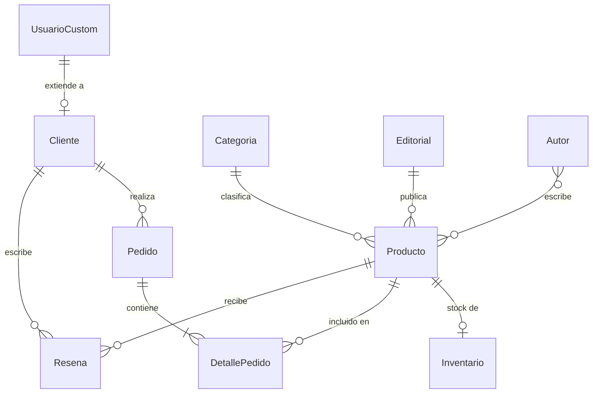

# La Frikicueva - Backend (API REST)

**Evaluación Final Integradora (EFI) - Ingeniería de Software 2026** · Docente: Facundo Esteban Lemo

"La Frikicueva" es una tienda especializada en cómics, mangas y libros de fantasía épica. Este repositorio es su **backend**: una API REST hecha con **Django** y **Django REST Framework** que expone el catálogo, los clientes, los pedidos y las reseñas para ser consumidos por un frontend independiente.

## Equipo de desarrollo
* Lucas Aruza
* Mateo Gonzalez

## Stack
Django · Django REST Framework · django-filter · drf-spectacular (Swagger/ReDoc) · django-cors-headers · SQLite · **uv** · **Docker**

## Planificación de la base de datos

El sistema tiene **10 modelos** relacionados entre sí:



| # | Modelo | Descripción y relaciones |
|---|---|---|
| 1 | **UsuarioCustom** | Extiende `AbstractUser` y agrega `telefono`. Maneja la autenticación. |
| 2 | **Categoria** | Clasifica los productos (Cómic, Manga, Fantasía). |
| 3 | **Editorial** | Empresas editoras (Panini, Ivrea). |
| 4 | **Autor** | Creadores, escritores o ilustradores. |
| 5 | **Producto** | Modelo central. `ForeignKey` a Categoria y Editorial (1 a N, `PROTECT`) y `ManyToMany` a Autor. |
| 6 | **Inventario** | `OneToOne` con Producto. Separa lo comercial (precio, título) del depósito físico (stock y pasillo). |
| 7 | **Cliente** | `OneToOne` con UsuarioCustom. Guarda dirección de envío y ciudad. |
| 8 | **Pedido** | `ForeignKey` a Cliente. Registra fecha, estado (Pendiente, Enviado, Cancelado) y total. |
| 9 | **DetallePedido** | `ForeignKey` a Pedido y Producto. Guarda la cantidad y "congela" el precio unitario al momento de la compra. |
| 10 | **Resena** | `ForeignKey` a Producto y Cliente. Puntaje de 1 a 5 y comentario; un cliente reseña una sola vez cada producto. |

## Instalación y ejecución

### Con Docker (recomendado)
```bash
docker compose up --build
```
El contenedor aplica las migraciones al iniciar. En otra terminal:
```bash
docker compose exec web python manage.py createsuperuser
docker compose exec web python populate.py     # carga datos de ejemplo (y el usuario cliente_demo / demo1234)
```

### En local con uv
```bash
uv sync
uv run python manage.py migrate
uv run python manage.py createsuperuser
uv run python populate.py
uv run python manage.py runserver
```

Las variables de entorno son opcionales (hay valores por defecto para desarrollo). Ver `.env.example`.

### Accesos del sistema
| Qué | URL |
|---|---|
| Vista de bienvenida | http://localhost:8000/ |
| API navegable | http://localhost:8000/api/ |
| Swagger (documentación) | http://localhost:8000/api/docs/swagger/ |
| ReDoc | http://localhost:8000/api/docs/redoc/ |
| Panel de administración | http://localhost:8000/admin/ |

## API

### Endpoints (`/api/`)
| Recurso | Ruta | Quién puede escribir |
|---|---|---|
| Categorías, editoriales, autores, productos, inventario | `categorias/`, `editoriales/`, `autores/`, `productos/`, `inventario/` | Solo staff (lectura pública) |
| Clientes | `clientes/` | Cada usuario gestiona su perfil; el staff ve todos |
| Pedidos | `pedidos/` | Usuario autenticado (cada uno ve solo los suyos) |
| Detalles de pedido | `detalles/` | Usuario autenticado, sobre sus pedidos pendientes |
| Reseñas | `resenas/` | Su autor (lectura pública) |

### Autenticación (Token y Sesión)
* **Token:** `POST /api/auth/registro/` (crea usuario y devuelve token) · `POST /api/auth/login/` (devuelve token) · `POST /api/auth/logout/`.
  Se usa con el header `Authorization: Token <token>`.
* **Sesión:** login desde la API navegable en `/api-auth/login/`.

```bash
curl -X POST http://localhost:8000/api/auth/login/ -H "Content-Type: application/json" \
     -d '{"username": "cliente_demo", "password": "demo1234"}'
curl http://localhost:8000/api/pedidos/ -H "Authorization: Token <token>"
```

### Datos anidados solo en el listado
`GET /api/productos/` y `GET /api/pedidos/` devuelven categoría, editorial, autores / cliente y detalles **anidados** (NestedSerializers). El detalle (`/api/productos/1/`) y las escrituras usan el serializador plano.

### Paginación, filtros y búsqueda
Todos los listados vienen **paginados** (`?page=2`, 10 por página). Los productos permiten:
`?search=berserk` · `?categoria=2` · `?editorial=1` · `?autor=3` · `?precio_min=5000&precio_max=15000` · `?en_stock=true` · `?ordering=-precio`

### Acciones personalizadas (`@action`)
| Acción | Método y ruta | Descripción |
|---|---|---|
| `economicos` | `GET /api/productos/economicos/` | Productos de menos de $10.000 |
| `resenas` | `GET /api/productos/{id}/resenas/` | Reseñas de un producto |
| `bajo_stock` | `GET /api/inventario/bajo_stock/?limite=5` | (Staff) productos a reponer |
| `cancelar` | `POST /api/pedidos/{id}/cancelar/` | Cancela un pedido pendiente y devuelve el stock |
| `enviar` | `POST /api/pedidos/{id}/enviar/` | (Staff) marca el pedido como enviado |

### Lógica de negocio de los pedidos
* Al agregar un detalle, el **precio** lo toma el sistema del producto (queda congelado) y se **descuenta el stock**.
* El **total** del pedido se recalcula automáticamente al agregar o quitar detalles.
* Si no hay stock suficiente, la API responde 400.
* Al cancelar un pedido, el stock vuelve al inventario.

## Panel de administración
Todos los modelos están registrados con listados, filtros, búsqueda y orden. Los productos se editan junto a su inventario y los pedidos junto a sus detalles; además hay una acción masiva para marcar pedidos como enviados.

## CORS
Configurado con `django-cors-headers`. Por defecto permite `localhost:3000` y `localhost:5173`; se pueden agregar más orígenes con la variable `CORS_ALLOWED_ORIGINS`.

## Tests
```bash
uv run python manage.py test            # local
docker compose exec web python manage.py test
```
Cubren permisos, autenticación por token, paginación, datos anidados, filtros, acciones y el flujo completo de compra y cancelación.

## Organización con Git
* `main`: versión estable y de entrega.
* `develop`: integración del trabajo del equipo.
* Ramas `feature/...` o `fix/...` para cada cambio, integradas mediante Pull Request y con commits descriptivos.

## Capturas del proyecto en funcionamiento


